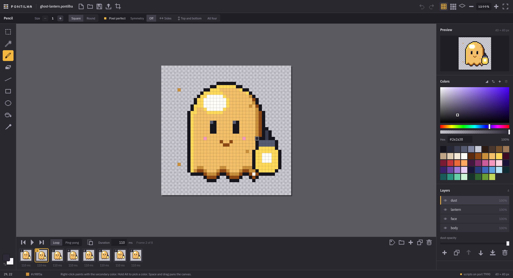

# Pontilha

A pixel art editor for Linux. You can draw yourself, with a mouse or a drawing tablet, or an
AI agent can send commands to the open window, as with the ArtCraft apps. Either way, every
step shows up on screen as it happens.



## Usage

- Open: `pontilha` (or from the app launcher).
- Shortcuts: M select, W magic wand, B pencil, E eraser, L line, U rectangle, O ellipse, G fill, I eyedropper, X swaps the
  colors, `[` and `]` change the brush size, holding Alt picks a color, Space and drag pans the
  canvas, Ctrl+Z/Ctrl+Shift+Z undo and redo, Ctrl+S saves, Ctrl+E exports (PNG, sprite sheet or GIF).
- Native format: `.pontilha` (layers, frames and palette). PNG export never blurs, at any
  whole-number scale.

## Tiles and isometric

In the top bar, tile mode shows the image repeated around itself, dimmed, so you can check
that a tile's edges meet. The isometric grid draws 2:1 lines with tiles 16, 32 or 64 px wide,
as a guide for mobis. Both are shown on screen only.

## Symmetry

Pencil, eraser, line, rectangle, ellipse and fill have Symmetry in the options bar: ↔ Sides
repeats what you paint across the vertical center line, ↕ Top and bottom across the
horizontal one, and All four across both. The center lines are shown on screen while it is on.

## Colors

In the Colors panel:

- Ramp (stairs icon): creates 3 to 9 colors around the primary color, with darker, more
  saturated shadows leaning toward blue and lighter highlights leaning toward yellow; the hue
  shift per step is adjustable. The colors go into the palette without duplicates.
- Replace color (arrows icon): replaces a used color with another across the whole image, only
  in the active layer or only in the current frame, as one undo step. Good for recoloring a
  whole animation or making variants of a badge.

## Image size

The crop button in the top bar opens Image size. Everything applies to every layer and frame,
and Ctrl+Z undoes it:

- Canvas: new width and height without stretching the art; the 9 small squares choose where
  the current image goes. Shrinking cuts off whatever doesn't fit.
- Scale up: each pixel becomes a 2×, 3×, 4× or 8× block.
- Crop: trim the empty borders around the art, or crop to the selection (also in the Select
  tool's bar).

## Autosave

While there are unsaved changes, Pontilha keeps a copy every minute in
`~/.config/pontilha/recovery.pontilha`. Saving, or closing and choosing not to save, deletes
the copy. If the app closes any other way (it crashed, it was killed), it offers to recover
the work the next time it opens.

## Selection

With the Select tool (M), drag to select a rectangle and drag inside it to move the pixels.
The magic wand (W) selects by color: only the area connected to the click, or the same color
across the whole layer; the selection follows the shape, and move, flip, rotate, copy and erase
apply only to its pixels. Shift adds to the selection with both tools. The options bar and the
shortcuts act on the selection, or on the whole layer when nothing is selected:

- With something selected, the arrows move it 1 px (Shift+arrows, 8 px). Shift+H and Shift+V flip; Shift+R rotates 90°.
- Ctrl+C copies, Ctrl+X cuts, Ctrl+V pastes in the same place it was copied from (handy for
  carrying a part to another frame). Delete erases; Ctrl+A selects all; Ctrl+D or Esc deselects.
- Undo restores the pixels and the selection together.

## Animation

The timeline sits below the canvas. Each frame has one image per layer and its own duration
in milliseconds.

- `+` creates an empty frame, the duplicate button copies the current one, the trash can deletes it.
- Drag a thumbnail to reorder (or Shift+arrows with it selected).
- `,` and `.` step through frames; Enter plays and pauses, in Loop or Ping-pong.
- Onion skin shows neighboring frames underneath, very faint: 0 to 3 before and after, and
  Tinted colors the previous ones red and the next ones blue.
- Add tag (label icon) names a range of frames, like "walk" or "jump". The name appears above
  the thumbnails; clicking it makes playback loop over just that range, and sprite sheet and
  GIF export can output just that range.
- Import sprite sheet (folder icon in the timeline) slices a PNG into frames, left to right and
  top to bottom, leaving out empty cells at the end.
- Version 1 projects (without frames) still open; saving turns them into version 2.
- Export (Ctrl+E): the current frame as PNG, every frame in a sprite sheet (in a row or a grid)
  or an animated GIF that loops forever, with optional ping-pong. GIF holds up to 256 colors
  and each pixel is either opaque or transparent.

## Effects, computed loops and recipes

Ideas taken from Pixel Composer's node graphs (the Boo project), as commands for agents and
scripts. Each one is a single undo step, even when it changes several frames.

- Palette: `palette.preset` (bubie, slso8, boo, pico8, sweetie16); `effect.posterize` forces
  every pixel to the nearest palette color, with optional ordered dithering; `color.check`
  lists what falls outside it.
- Volume from the edge: `effect.shade` paints the lit side and the shadow side from the light
  direction; `effect.bands` makes bands by distance to the edge (rims and highlights);
  `effect.blobify` melts nearby shapes into a rounded blob.
- Looping motion without redrawing: `anim.oscillate` bobs a layer (with `phase` so an accessory
  follows a little late), `effect.wave {animate: true}` ripples a hem or a cape, and
  `draw.particles` releases dust or sparkles that respawn on every loop.
- Recipes: `recipe.start` … `recipe.stop` records the commands that build a piece and stores
  them in the `.pontilha`; `recipe.run {colors: {"#from": "#to"}}` rebuilds the piece in other
  colors. The file also stores a PNG thumbnail (`thumbnail`) for galleries.

Full example in `examples/ghost-lantern/`.

## Control from agents and the terminal

While the window is open, it listens on `127.0.0.1:7990` (port and token published in
`~/.config/pontilha/`; turn it off with `--no-control`).

- MCP: `pontilha mcp`, already registered in Claude Code as `pontilha`. Tools follow the
  ArtCraft convention: `command_list`, `command_run`, `command_batch`, `doc_new`, `doc_open`,
  `doc_place`, `doc_save`, `doc_export`, `doc_inspect`, `render_preview`, `app_open`.
- Terminal: `pontilha status`, `pontilha commands`, `pontilha run draw.rect '{"x":0,"y":0,"w":4,"h":4}'`,
  `pontilha run examples/badge-star.json`, `pontilha preview`, `pontilha export out.png 4`,
  `pontilha export sheet.png 4 grid`, `pontilha export anim.gif 4 pingpong`.
- Skill: `~/.claude/skills/pontilha/SKILL.md`.

## Development

```sh
bun install
bunx tauri dev                 # window with live reload
bun run test                   # drawing engine and commands
bunx tauri build --no-bundle   # final binary in src-tauri/target/release/pontilha
```

- `src/core/`: the engine (pixels, rasterization, history, PNG, project format), no DOM.
- `src/automation/commands.ts`: the commands agents and scripts use.
- `src/canvas/`, `src/ui/`: drawing canvas and panels (React).
- `src-tauri/src/control.rs`: control port; `cli.rs`: command line and MCP server.
